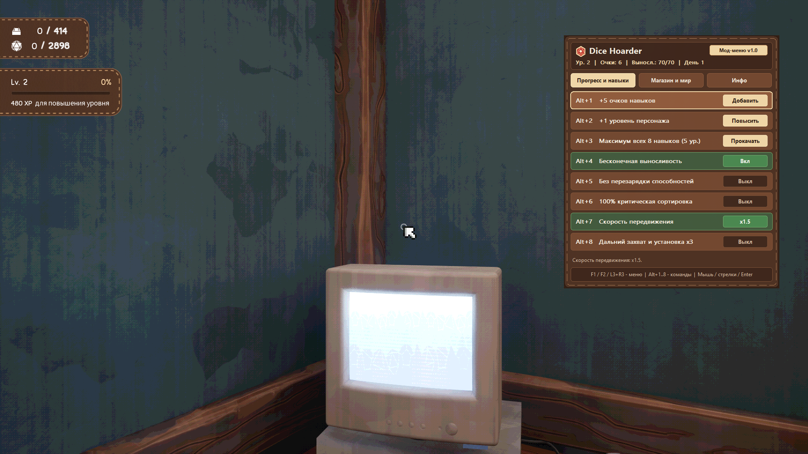
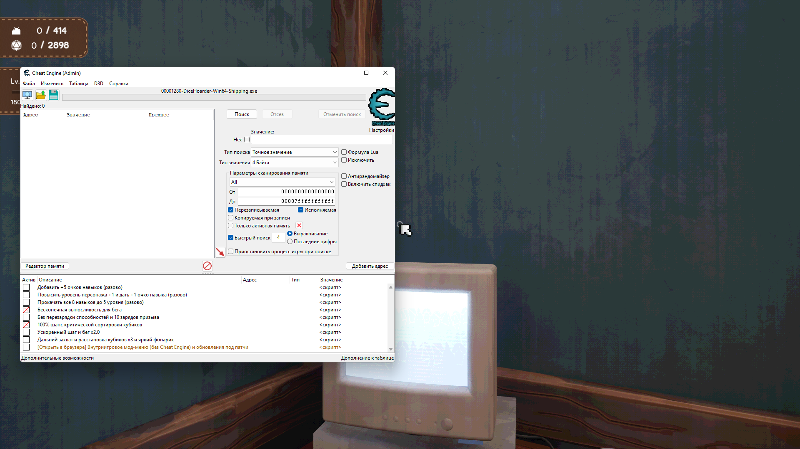

# Dice Hoarder - Внутриигровое мод-меню (v1.0)

Мод-меню на русском, готовое стартовое сохранение и таблица Cheat Engine для **Dice Hoarder** (версия `1.0`, Windows и Steam Deck).

## Скачать
- **[Полное мод-меню v1.0 на Boosty (ранний доступ до 28 ноября: подписка от 120 ₽ со скидкой 20% или разовая покупка поста за 120 ₽, далее открыто всем)](https://boosty.to/cd_tixo/posts/0585ec01-e32d-46a6-87fe-edee2045a9fc?utm_source=github&utm_medium=readme&utm_campaign=dice_hoarder)**
- **[Таблица .CT и стартовое сохранение на GitHub Releases](https://github.com/neoru-droid/dice-hoarder-mod-ru/releases)**

Поддерживаются **Windows 10 / 11** и **Steam Deck / Linux (Proton)**.

## Установка

1. **Windows:** закройте игру, распакуйте `DiceHoarder-Trainer-RU-v1.0.zip` и запустите `DiceHoarder-Trainer-Setup.exe` -> **«Установить мод-меню»**.
2. **Steam Deck / Linux (Proton):** распакуйте файлы архива в одну папку и выполните `sh install-steamdeck.sh`.
3. В игре откройте панель клавишей `F1`, `F2` или комбинацией `L3 + R3` на геймпаде.
4. **Удаление:** запустите установщик и нажмите **«Удалить мод-меню»** (или `sh install-steamdeck.sh --uninstall`).

## Возможности мод-меню

### Вкладка «Прогресс и навыки»
1. `Alt+1` - **+5 очков навыков**
2. `Alt+2` - **+1 уровень персонажа**
3. `Alt+3` - **Максимум всех 8 навыков (5 ур.)**
4. `Alt+4` - **Бесконечная выносливость**
5. `Alt+5` - **Без перезарядки способностей**
6. `Alt+6` - **100% критическая сортировка**
7. `Alt+7` - **Скорость передвижения (x1.0 / x1.5 / x2.5)**
8. `Alt+8` - **Дальний захват и установка x3**

### Вкладка «Магазин и мир»
1. **Скорость игрового времени (x1.0 / x1.5 / x2.0)**
2. **Яркий фонарик x3**
3. **Переключение времени суток (утро / вечер / ночь)**
4. **Защита от поимки**
5. **Авто-крафт следующего набора**
6. **Автосортировка одного набора**

## Таблица Cheat Engine (`DiceHoarder_RU_v1.0.CT`)

Отдельная русская таблица для Cheat Engine 7.5+ (`DiceHoarder-CheatTable-RU-v1.0.zip`) подключается к процессу `DiceHoarder-Win64-Shipping.exe`: +5 очков навыков, повышение уровня, прокачка всех 8 навыков до 5 уровня, бесконечная выносливость, отключение перезарядки способностей, 100% критическая сортировка, ускоренный бег x2.0 и дальний захват x3.

## Стартовое сохранение (`DiceHoarder-Save-v1.0.zip`)

Готовое сохранение сюжетного режима с повышенным уровнем персонажа и запасом очков навыков. Распакуйте содержимое папки `SaveGames` в `%LOCALAPPDATA%\DiceHoarder\Saved\SaveGames`.

## Обратная связь и проекты автора

Заметили баг после патча игры - пишите в [Issues](https://github.com/neoru-droid/dice-hoarder-mod-ru/issues).

Предложить свою игру в приоритетную очередь (350 ₽) или заказать разбор вне очереди (750 ₽) можно на [странице Boosty](https://boosty.to/cd_tixo?utm_source=github&utm_medium=readme&utm_campaign=order_game).

Все проекты автора: [сайт каталога](https://neoru-droid.github.io/) · [каталог на Boosty](https://boosty.to/cd_tixo/posts/2a55d7e9-0f53-4d93-9f66-280981158dec?utm_source=github&utm_medium=readme&utm_campaign=dice_hoarder) · [профиль на GitHub](https://github.com/neoru-droid)

Лицензия: [MIT](LICENSE)

Автор: `neoru-droid`
