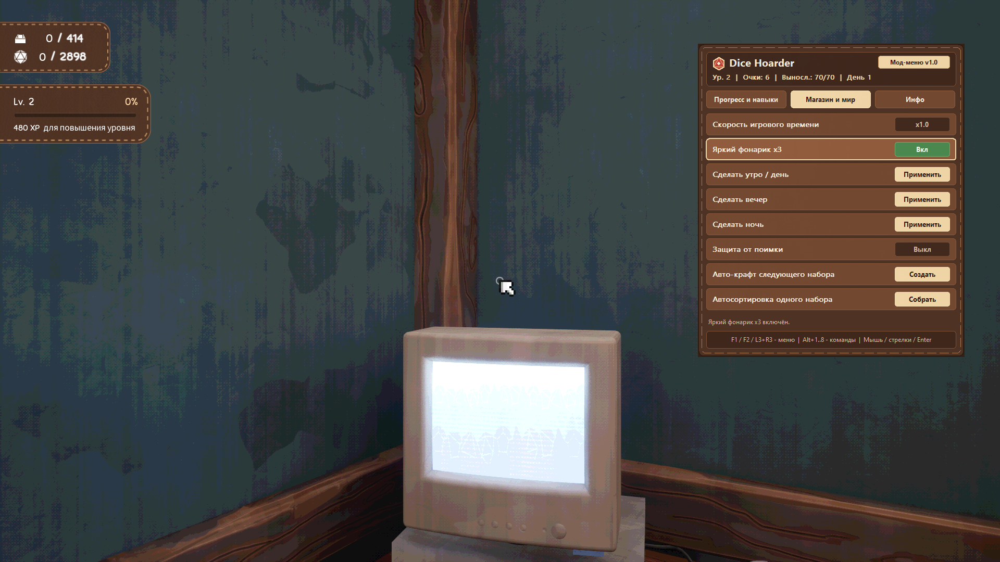

# Dice Hoarder - Мод-меню, сохранение и таблица .CT

Сохранение на 4 уровень, прокачка всех 8 навыков, бесконечная выносливость, дальний захват `x3` и автосортировка + таблица `.CT` (`v1.0`, Windows и Steam Deck).

## Скачать
- **[Полное мод-меню v1.0 на Boosty (ранний доступ 7 дней до 28 ноября: 120 ₽/мес на все релизы или разовый пост 150 ₽, далее открыто всем)](https://boosty.to/cd_tixo/posts/0585ec01-e32d-46a6-87fe-edee2045a9fc)**
- **[Таблица .CT и стартовое сохранение на GitHub Releases](https://github.com/neoru-droid/dice-hoarder-mod-ru/releases)**
- **Заказ своей игры:** в очередь - `350 ₽`, разбор вне очереди - `750 ₽` на [Boosty](https://boosty.to/cd_tixo)

## Установка
1. **Windows:** закройте игру, распакуйте `DiceHoarder-Trainer-RU-v1.0.zip` и запустите `DiceHoarder-Trainer-Setup.exe` -> **«Установить мод-меню»**.
2. **Steam Deck / Linux (Proton):** распакуйте архив и выполните `sh install-steamdeck.sh`.
3. **В игре:** `F1` / `F2` или `L3 + R3` открывает окно. Удаление - кнопка в установщике или `sh install-steamdeck.sh --uninstall`.

## Функции мод-меню

- **Прогресс и навыки:** `Alt+1` `+5` очков навыков, `Alt+2` `+1` уровень, `Alt+3` максимум всех 8 навыков (5 ур.), `Alt+4` бесконечная выносливость, `Alt+5` без перезарядки, `Alt+6` 100% критическая сортировка, `Alt+7` скорость (`x1.5 / x2.5`), `Alt+8` дальний захват `x3`.
- **Магазин и мир:** скорость времени (`x1.5 / x2.0`), фонарик `x3`, смена времени суток, защита от поимки, авто-крафт и автосортировка набора.

## Таблица .CT и стартовое сохранение

- **Таблица (`DiceHoarder-CheatTable-RU-v1.0.zip`):** 8 основных функций для `DiceHoarder-Win64-Shipping.exe` в Cheat Engine 7.5+.
- **Сохранение (`DiceHoarder-Save-v1.0.zip`):** 4 уровень и запас очков навыков -> распаковать `SaveGames` в `%LOCALAPPDATA%\DiceHoarder\Saved\SaveGames`.

Нашли баг после патча - пишите в [Issues](https://github.com/neoru-droid/dice-hoarder-mod-ru/issues).

[Сайт каталога](https://neoru-droid.github.io/) · [Каталог на Boosty](https://boosty.to/cd_tixo/posts/2a55d7e9-0f53-4d93-9f66-280981158dec) · [Telegram](https://t.me/neoru_droid) · [GitHub](https://github.com/neoru-droid) · [MIT](LICENSE) · Автор: `neoru-droid`
